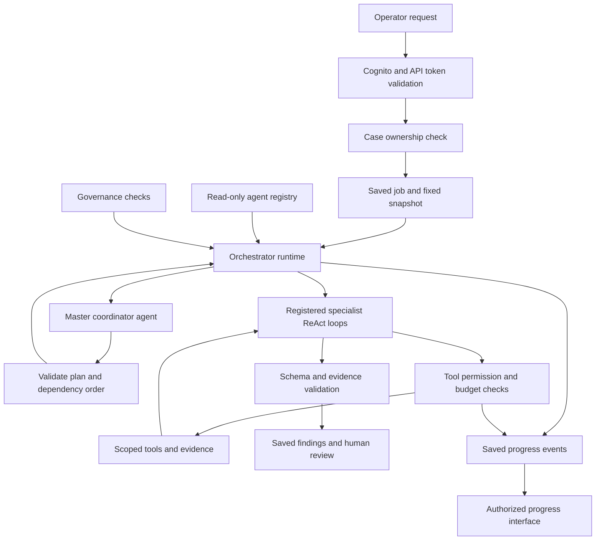

# Bounded multi-agent operation

Date: 2026-10-10.
Status: Previous proposal, kept for review history. Not the current recommendation.

The [AWS review](arch-agent-aws-review.md) recommends one bounded agent with orchestration in code.
It keeps two specialists as an evaluation candidate and removes the AI master from the recommendation.
The seven-role allocation that follows is untested. The project did not adopt it.

Read the [comparison](arch-agent-operation-comparison.md) before this proposal.
The [current blueprint](02_TECHNICAL_BLUEPRINT.md) is the approved design.

## Decision ownership

| Item | Origin and status |
| --- | --- |
| Different jobs, limits, ReAct, master orchestrator, registry, streaming tools, governance | Requested by the user. |
| Role division, local allowances, registry fields, and transfer rules that follow | Proposed in this document. |
| 24 model calls, 600 seconds, 20 obligations, case isolation, India boundary | Inherited limits. |
| External regulatory API and no crawler | Inherited source design. Provider selection is undecided. |
| Better accuracy or lower cost | Unverified. The comparison evaluation is necessary. |

## Terms

| Term | Meaning |
| --- | --- |
| Agent | A model-driven component that selects permitted actions to complete one assigned job. |
| ReAct loop | A repeated cycle of reasoning, tool action, and observation. |
| Runtime | Application code that executes and validates agent actions. |
| Master coordinator | The agent that selects a permitted work plan and requests registered specialist jobs. |
| Orchestrator service | The coordinator and the runtime that controls its execution. |
| Registry | A versioned list of permitted agents, tools, schemas, and limits. |
| Governance | Rules for access, evidence, source versions, budgets, review, and audit records. |
| Handoff | A validated transfer of one role's result to a different role. |

ReAct is the agent pattern described in the [ReAct paper](https://arxiv.org/abs/2210.03629).
React is the browser interface library.
The two names refer to different technologies.

## Master orchestrator and authentication

The orchestrator service receives an authorized assessment job.
Cognito authenticates the operator.
API validation examines the token before application processing.
Application code validates case ownership before it makes or reads a job.

The model does not validate credentials or give permissions.
It receives a validated identity reference and a fixed scope.
Each tool call must pass a subsequent scope and permission check.

AWS API Gateway supports token validation before the integration receives a request.
Refer to [JWT authorizers](https://docs.aws.amazon.com/apigateway/latest/developerguide/http-api-jwt-authorizer.html).
Token validation does not replace the application's case-ownership check.

The coordinator can examine role definitions and safe job summaries.
It can request registered roles in a permitted dependency order.
It cannot add agents, expand source scope, change permissions, or increase the total allowance.

The runtime validates its plan before dispatch.
The runtime puts accepted results together. It does not ask the coordinator to rewrite findings.
The runtime sets completion from validated scope and saved execution state.

## Logical structure

These are logical roles.
One worker can host the coordinator and all specialist loops.
Different agents do not make different Lambda services or different model providers necessary.
Keep the approved model and region verification gates.

## One job per agent

Each role owns one result type.
It can use several permitted tools to produce that result.
It cannot edit a different role's result.

The allowances that follow apply across the full assessment.
They do not restart for each obligation, batch, or resumed execution.
Count each model invocation independently. Include tool-result continuations and final-output calls.

| ID | Role | One assigned job | Result | Base call cap | Elapsed-time cap |
| --- | --- | --- | --- | ---: | ---: |
| A0 | Master coordinator | Select a permitted execution plan. Monitor its execution. | Execution plan and coordination summary. | 2 | 45 seconds |
| A1 | Change agent | Find substantive differences between selected regulatory versions. | Cited change set. | 2 | 45 seconds |
| A2 | Obligation agent | Write selected regulatory requirements as accurate obligations. | Obligation set with conditions and exceptions. | 3 | 75 seconds |
| A3 | Applicability agent | Find whether each selected obligation is applicable to the case. | Applicable, inapplicable, or unresolved decisions. | 3 | 60 seconds |
| A4 | Control mapping agent | Connect applicable obligations to stated bank controls. | Mappings with cited control details and unknown fields. | 4 | 90 seconds |
| A5 | Evidence assessment agent | Classify what the supplied evidence shows for each obligation. | Findings with evidence gaps, control gaps, and uncertainty. | 5 | 120 seconds |
| A6 | Remediation agent | Propose a response to each accepted gap or evidence request. | Cited correction proposals or evidence requests. | 3 | 60 seconds |
| Reserve | Runtime allowance | Let the runtime do a bounded repair or retry after a rejected or failed model response. | No other agent. | 2 | Inside existing deadlines. |
| Total | Complete job | Complete only the selected scope. | Validated result or visible result with work that is not completed. | 24 | 600 seconds |

The base allowances total 22 calls.
The runtime can give one more repair call to a role from the two-call reserve.
No role can receive more than one reserve call.
Unused allowances do not authorize more work or more agents.

Local time limits include model time, tool time, and retries while the role is active.
Time for a previous role uses part of the global deadline.
The role timer does not reset on resume.

The global deadline starts when the assessment worker starts.
It includes regulatory verification, orchestration, tool work, retries, and finalization.

Stop at the first applicable limit.
Set each call timeout within the remaining time.
Do not dispatch new work after the deadline.
Late responses cannot complete an expired assessment.
Dispatched calls still count when cancellation cannot stop them.

These allocations are testable proposals, not demonstrated capacity.
They may not be sufficient for 20 difficult obligations.
Use development results to change the allocation before you fix the evaluation configuration.
Do not decrease the selected scope without a warning to stay within the limit.

## Dependencies and source checks

Before any current assessment, the source adapter makes sure that the selected regulatory versions are current.
Failed verification or changed selected versions stops that assessment.
The coordinator cannot override this condition.

Start A1 only for a selected version-comparison job with both versions selected.
Skip A1 for an ordinary assessment with unchanged selected sources.
Its output cannot replace the assessment snapshot without a warning.

The primary assessment order is A2, A3, A4, A5, then A6.
Keep inapplicable and unresolved decisions in the final result.
Do not send unresolved applicability to a supported finding.
If a finding makes no action necessary, do not invent a remediation task.

The first proposal uses one specialist at a time.
This keeps recovery and allowance-enforcement logic small.
Multi-agent operation does not make execution at the same time necessary.
A measured benefit from parallel execution and coordination tests are necessary.

## ReAct loop and stop rules

Each agent uses this loop within its assigned job:

1. Read the assigned scope and remaining allowances.
2. Select the next permitted action or propose the final result.
3. Ask the runtime to validate the action.
4. If permitted, let the tool execute.
5. Examine the tool result as untrusted evidence.
6. Continue only if necessary work is not completed and one more call is permitted.

The final result ends the loop only after runtime validation.
Rejected output consumes its model call.
A repair must fit within the same role and job allowances.
Repeated actions with unchanged input and no new evidence stop the loop.
Specialists cannot make child agents or call a different specialist directly.

A role must select actions from observations.
A sequence of fixed prompts alone does not meet this ReAct contract.
Storage or streaming of the model's internal reasoning is not mandatory.

The runtime must reserve each model call before dispatch.
It must save the reservation atomically, as one indivisible operation.
Failed, malformed, rejected, repeated, and uncertain dispatched calls count.
Queue redelivery cannot reset any counter or deadline.
Retries use saved stage results and execution claims.

## Registry and tool permissions

Keep the registry as versioned configuration for the first implementation.
Do not add an agent marketplace or dynamic agent installation.
The runtime reads the registry. Models cannot change it.

| Registry field | Required content |
| --- | --- |
| Identity | Stable agent ID, role version, enabled state, and instruction version. |
| Job | One purpose, necessary inputs, output schema, and completion conditions. |
| Dependencies | Permitted previous roles and permitted next roles. |
| Model | Approved model profile and permitted processing regions. |
| Tools | Permitted tool names, argument schemas, and data classes. |
| Limits | Call cap, time cap, retry rules, tool limits, and output limits. |
| Evidence | Mandatory source references, uncertainty fields, and validation rules. |

The coordinator receives registry summaries and job metadata.
Raw bank documents are not necessary for the coordinator.

A1 and A2 read selected regulatory evidence.
A3 reads the bank profile and obligation sources.
A4 reads scoped controls and obligations.
A5 reads scoped evidence and its related requirements and controls.
A6 reads validated findings and their permitted source references.

Private text cannot pass to the external regulatory API.
Public queries must use configured fields and permitted endpoints.
The source adapter, not an agent, holds provider credentials.
Permission checks must consider both the role and the requested resource.

Use different limits for tools and model calls.
Before implementation, set maximum requests, pagination, response size, and timeout for each tool.
Before live evaluation, set per-call model input/output limits and a job token allowance.
Missing limits must block tool activation.
Use the provider contract and measured task size to set these values.
The 24-call limit alone does not give a fixed monetary cost.

## Handoff contract

Send structured results and exact source references.
Do not send only an agent's prose summary.
These items are necessary for each handoff:

- Job, case, snapshot, task, and parent-task identifiers.
- Agent, instruction, model, registry, and schema versions.
- Selected obligation IDs, source versions, passage IDs, and examined scope.
- Specified conditions, exceptions, unresolved questions, and validation status.
- Completed work, remaining work, and consumed allowances.

The runtime supplies validated identity and scope.
It must reject model-provided replacements for those values.
Subsequent agents can examine the cited passages through scoped tools.
A previous agent's conclusion is not an authoritative source.
Unresolved contradictions related to the requirement prevent a supported finding.

## Streaming tools and governance

Tools send progress events while they work.
The runtime validates and saves those events in order.
Each event identifies its job, role, action, sequence, time, and status.
Send events from recorded execution. Do not invent model progress.

Example events include `agent_started`, `tool_started`, `tool_progress`, `tool_finished`, `output_rejected`, and `job_stopped`.
Do not stream hidden reasoning, credentials, raw prompts, or unvalidated private text.
The authorized result interface handles evidence and findings independently.

Internal event streaming can support the approved polling interface.
Polling is not browser push streaming.
If browser push streaming is necessary, set its transport independently. Test that transport independently.
Do not claim a long-lived connection through the current request API without integration verification.

Governance checks apply before model dispatch, before tool execution, and before result publication to the case owner.
They enforce identity, role permissions, current sources, fixed snapshots, allowances, and evidence rules.
The master coordinator cannot give an exemption to itself or a different role.

Save human review decisions independently from AI findings.
An AI review is not proof of independent human approval.
No agent can change bank systems, send messages, or publish reports externally.
Keep the existing India processing boundary and private logging rules.

## Required tests before implementation acceptance

These are proposed tests. The project did not do them.
Write failing behavior tests before application code.

| Test ID | Required behavior |
| --- | --- |
| MA-01 | Reject an invalid token before agent dispatch. |
| MA-02 | Deny another case's evidence during every role and handoff. |
| MA-03 | Reject unknown agents, tools, and altered registry fields. |
| MA-04 | Deny the 25th dispatched model call across all roles and retries. |
| MA-05 | Keep local caps and the 600-second deadline after redelivery. |
| MA-06 | If source verification does not pass or selected versions change, stop before assessment. |
| MA-07 | Reject a handoff that omits a necessary exception or changes the snapshot. |
| MA-08 | Stop repeated tool requests that produce no new evidence. |
| MA-09 | If a role has no remaining allowance, keep partial results and unchecked work. |
| MA-10 | Keep credentials, raw private text, and hidden reasoning out of streamed events. |
| MA-11 | Do not let the coordinator change a validated finding. Do not let it give approval to its own exemption. |
| MA-12 | Compare both designs on the same held-out cases and equal total limits. |

Software checks can validate fields and references.
Domain evaluations must test whether a transfer changed the meaning of a condition or exception.
Controlled model responses are not proof of live assessment quality.

## Files affected if this proposal is adopted

Revise D09, the technical blueprint, security rules, frontend events, delivery tickets, tests, and evaluations.
Add the agent requirement and acceptance conditions to the PRD.
Regenerate the ArchView and Draw.io diagrams from the revised source.
Keep the current one-agent design for the evaluation comparison.
Do not describe this proposal as an implemented system.
